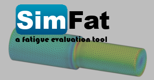
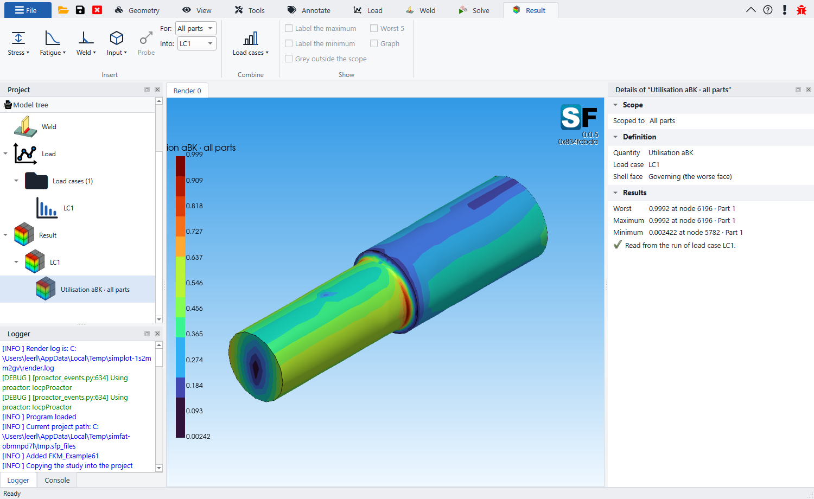

  

  <b>Fatigue evaluation of structures, straight from their finite element models.</b> 
  <a href="https://github.com/linntech-labs/SimFat/releases">Download</a> ·
  <a href="https://github.com/linntech-labs/SimFat/issues/new?template=bug_report.yml">Report a bug</a> ·
  <a href="https://github.com/linntech-labs/SimFat/issues/new?template=feature_request.yml">Request a feature</a> ·
  <a href="https://simfat.org/">simfat.org</a>

---

SimFat evaluates the fatigue of a structure from its finite element model. You
bring a solved FE study and the loads the part sees in service; SimFat turns
them into a stress history at every surface node, counts it, and puts it on the
part's S-N curve -- by the FKM guideline, by an S-N curve of your own, or, for a
weld, by the structural hot spot method -- and shows the damage, life,
utilisation and safety factor on the model.

   
  The damage of FKM Example 6.1, shown on the shaft.

## What it does

- **FE models** from CalculiX, PTC Creo Simulate, Nastran and SolidWorks
  Simulation -- solids and shells, both faces of a shell.
- **Evaluation** by the FKM guideline (5th edition, local stresses), by a
  user-defined S-N curve, and welds by the structural hot spot method of
  DNV-RP-C203.
- **Loads**: the FE model's own steps, other studies on the same mesh, time
  series and load spectra; superposed linearly or interpolated between steps.
- **Load cases**: bins typed in, a history, or a sequence of histories with
  their repeats. Rainflow counting (ASTM E1049).
- **Multiaxial loading**: a critical plane search for loads that do not act in
  proportion.
- **Results** on the model: damage, life, utilisation, safety factor, stresses
  and the counted spectrum; load cases combined; hot spots and probes.
- **A material and S-N curve library**, and libraries of your own.
- **The same evaluation from a terminal**: `simfat-cli run project.sfp`.

## Download and install

Every version is on the [Releases](https://github.com/linntech-labs/SimFat/releases)
page as one installer, `SimFat-<version>-win64-setup.exe`.

1. Download the installer of the version you want and run it. Until the
   installer is signed, Windows may say *Windows protected your PC*: choose
   **More info** › **Run anyway**.
2. Choose **Install for me only** (no administrator rights needed) or
   **Install for all users**.
3. Pick the parts: SimFat itself, its manual, and the example projects.

The manual comes with SimFat: **?** in the ribbon opens it.

### Versions and channels

| Channel | Versions | For |
|---|---|---|
| **Stable** | `0.3.0` | everyday work |
| **Beta** | `0.3.0-beta.2` | trying what comes next, before it is released |
| **Alpha** | `0.3.0-alpha.4` | the newest features, the least tested |

Alpha and beta versions are marked *Pre-release* on the Releases page.

### Updates

SimFat looks for a newer version on this page by itself, at most once a day,
and says so with an icon at the right end of its tab row -- nothing pops up.
One click downloads the update, and it installs when you close SimFat, over
the version you have: same folder, same settings, your projects untouched.
Every version is signed by Linnemann Tech, and SimFat checks the signature and
the download before anything is installed. To check, SimFat asks GitHub for
the list of versions and tells it only that it is SimFat and which version --
never your projects, licence or computer.

## System requirements

- Windows 10 or 11, 64-bit.
- 8 GB of memory; 16 GB or more for large models.
- About 2 GB of disk space, and room for the projects: a project keeps a copy
  of its FE study and its results.
- A graphics driver with OpenGL 3.2 or later.

## Reporting a bug

Use **Report a bug** in SimFat -- the bug button at the right end of its tab
row, or the button in an error message. It opens the
[bug form](https://github.com/linntech-labs/SimFat/issues/new?template=bug_report.yml)
here with your version, build and system already filled in, and the error too
when there was one. A GitHub account is needed to send it. Attach the project
or the FE model if it can be shared: a problem that can be reproduced is
fixed fastest.

## Requesting a feature

Something SimFat should do, or do differently? Use the
[feature request form](https://github.com/linntech-labs/SimFat/issues/new?template=feature_request.yml).
Say what you are trying to do and what stands in the way, more than how it
should be solved -- and name the standard and its section when it is about a
method. Requests are labelled *enhancement*; give one a 👍 to say you need it
too.

Questions that are neither: [kontakt@simfat.org](mailto:kontakt@simfat.org).

## Licence

SimFat is proprietary software of Linnemann Tech, licensed under the SimFat
End-User Licence Agreement, which the installer shows and SimFat keeps under
**!** › **License**. SimFat is built on open-source packages, each under its
own licence; **!** › **Open source** lists every one with its version and
licence.

This repository holds SimFat's releases and its issues. Its source is not
public.

   
  © 2018–2026 Linnemann Tech

